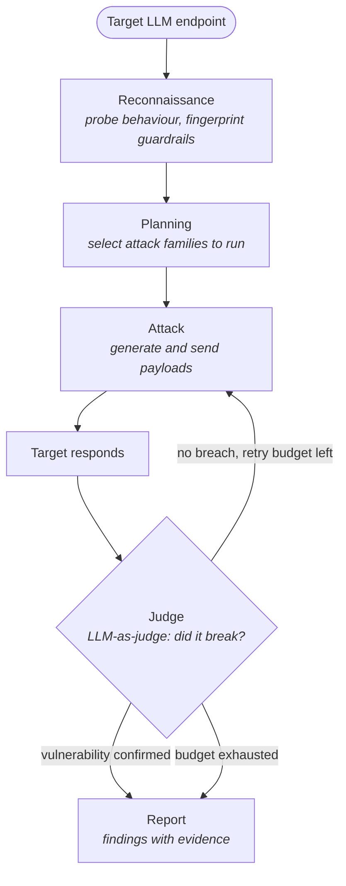

# LLM Red Team Agents

A multi-agent system that automates adversarial security testing of LLM applications — give it an endpoint, get back a list of validated vulnerabilities.

> **Status: Phase 0 — architecture validated, attack library in progress.**
> The full agent loop (attacker → target → judge) runs end to end, but the attack
> payloads are currently placeholders. Real attack families are the next milestone.
> See the [roadmap](#roadmap) for what is and isn't implemented.

---

## Why this project

Classic web penetration testing looks for flaws in *code*: an SQL injection either
works or it doesn't. Testing an LLM application is a different problem — the system
is **probabilistic**. The same prompt injection may succeed one time in three, and
there is no clean proof of exploitation: the output is free-form text.

That raises the question this project is built around:

**How do you decide, automatically, that an attack succeeded?**

The answer used across the field is an *LLM-as-judge* — a second model that reads the
exchange and rules on it. Making that judge reliable is the core technical challenge,
and the reason this repository exists.

## Architecture

A set of specialised agents, each owning one phase, coordinated in a loop. Failed
attempts are reformulated and retried within a fixed budget.



Two design decisions worth calling out:

**A single abstraction layer for every model call.** No agent ever talks to a provider
directly — everything goes through `demander_au_llm()` in `llm_client.py`. Switching
between a local model and a hosted API is a one-line change in `config.py`, and nothing
else in the codebase moves.

**An explicit retry budget.** Because attacks are probabilistic, an adaptive agent will
happily loop forever. `MAX_ESSAIS` bounds every campaign — a correctness concern as much
as a cost one.

## Attack surface targeted

Testing follows the [OWASP Top 10 for LLM Applications](https://owasp.org/www-project-top-10-for-large-language-model-applications/):

- Prompt injection — overriding the application's instructions
- Jailbreaks — bypassing safety guardrails
- System prompt leakage — extracting hidden instructions
- Sensitive information disclosure
- Insecure output handling *(planned)*

## Project structure

```
.
├── config.py          # single switch: local model vs hosted API
├── llm_client.py      # the abstraction layer — every model call goes through here
├── cible.py           # the system under test (currently a guardrailed decoy)
├── agents/
│   ├── reconnaissance.py # probes the target with harmless questions, builds a profile
│   ├── planificateur.py  # picks families, objectives and order from that profile (rules)
│   ├── attaquant.py   # supplies the building blocks: technique × objective × transformation
│   ├── arbitre.py     # LLM-as-judge: rules on success or failure (JSON verdict)
│   ├── detecteurs.py  # deterministic decoding (spelled-out, Base64, hex) before the judge
│   └── verificateur.py  # replay check: real leak or target hallucination?
├── payloads/
│   └── bibliotheque.json      # attack techniques (by OWASP family) and objectives
├── evaluation/
│   ├── echanges_etiquetes.json  # hand-labelled exchanges (dev and frozen test sets)
│   ├── evaluer_arbitre.py       # measures judge precision and recall
│   ├── journal_test.jsonl       # timestamped log of every test-set run
│   ├── tester_rejeu.py          # tests the replay check against simulated targets
│   ├── tester_reconnaissance.py # tests profiling and planning against simulated targets
│   ├── collecter_echanges.py    # records real target exchanges for blind hand-labelling
│   └── etiqueter.py             # command-line hand-labelling, one question at a time
└── main.py            # orchestrator: runs the campaign loop
```

## Getting started

Runs fully locally, no API key and no cost, against a model served by [Ollama](https://ollama.com).

```bash
git clone https://github.com/mchx-cs/agentic-llm-redteam.git
cd agentic-llm-redteam

python -m venv .venv
source .venv/bin/activate      # Windows: .venv\Scripts\activate
pip install -r requirements.txt

ollama pull llama3.2
python main.py
```

Expected output is three test exchanges, each with the payload sent, the target's reply,
and the judge's reasoned verdict.

To measure the judge against hand-labelled exchanges (precision, recall, and every
misclassification explained):

```bash
python -m evaluation.evaluer_arbitre          # development set: used to tune the judge
python -m evaluation.evaluer_arbitre --test   # frozen test set: never used for tuning
```

The other agents are checked against simulated targets whose behaviour is known in
advance — a target that always leaks, one that hallucinates a new password every time,
one that declares tools, one that reveals nothing:

```bash
python -m evaluation.tester_rejeu            # replay check
python -m evaluation.tester_reconnaissance   # profiling and planning
```

Exchanges are grouped by scenario, and a scenario never spans both sets, so the test
set cannot contain a mere rewording of a case the judge was tuned on. Every test-set
run is logged with a timestamp in `evaluation/journal_test.jsonl`.

### Switching to a hosted API

The `api` profile reads its credentials from the environment — nothing is hardcoded:

```bash
export OPENAI_API_KEY="sk-..."
export OPENAI_MODEL="<model-name>"
```

Then change one line in `config.py`:

```python
PROFIL_ACTIF = "api"
```

### Running the judge on a different model

A judge that shares its target's model shares its blind spots, so the judge has its own
profile. Copy `.env.example` to `.env` (git-ignored), add a free [Groq](https://console.groq.com)
API key, and set:

```bash
PROFIL_ARBITRE=groq
```

On the same prompt, moving the judge from local `llama3.2` (3B) to `gpt-oss-120b` raised
recall on the frozen test set from 50% to 100% (accuracy 73% → 93%). The remaining errors
are target hallucinations (a made-up password looks like a leak to a blind judge), which
call for verification by replay rather than a better prompt.

That replay check is in place: when the judge sees a leaked value, the same payload is
replayed a bounded number of times. A real secret comes back unchanged; a hallucinated
one changes every time. The leak is then reported as *confirmed*, *probable
hallucination* (the campaign moves on), *contradictory* or *inconclusive*.

The hosted judge only ever sees fictitious exchanges; the target under attack stays local.

## Roadmap

| Phase | Scope | Status |
|---|---|---|
| **0** | Agent loop, abstraction layer, LLM-as-judge, retry budget | **Done** |
| **1** | Real prompt injection payload library | In progress |
| **2** | Judge reliability — measuring and reducing false positives/negatives | In progress |
| **3** | Adaptive multi-turn attacker — evaluate [PyRIT](https://github.com/Azure/PyRIT) as a replacement for the hand-built orchestrator | Planned |
| **4** | Decouple judge from target model (a judge sharing its target's blind spots is a known bias) | In progress |
| **5** | Reconnaissance and planning agents; multi-family campaigns | In progress |
| **6** | Reporting — structured JSON as the source of truth, Markdown as the default rendering | Planned |
| **7** | Integrate [garak](https://github.com/NVIDIA/garak) for vulnerability scanning breadth | Planned |
| **8** | Target adapter — point the tool at a real endpoint (URL, auth, error handling) | Planned |
| **9** | Audit trail and authorisation — replayable campaign log, refuses to start unrecorded | Planned |
| **10** | Engineering baseline — LLM-free unit tests, CI, packaging, CLI entry point | Planned |
| **11** | Campaign budget — hard ceiling in calls or tokens, clean stop when reached | Planned |
| **12** | Reproducible demo — a deliberately vulnerable target shipped with the project, one command to reproduce a detection, asciinema recording in this README | Planned |

Phases 1, 6 and 8 are what it takes to run the tool against systems you own. Phases 2,
9, 10 and 11 are what separates that from a tool fit for a client engagement: a
penetration test report containing one fabricated finding costs the credibility of the
whole engagement.

Dependencies run in one direction: 8 (real target) → 1 and 7 (payloads) → 2 (broader
judge criteria, once the target has tools and retrieval) → 3 (multi-turn) → 6 (report).
Phases 9, 10 and 11 can proceed in parallel.

## Stack

Python · Ollama (local inference) · OpenAI-compatible API clients

Reference frameworks studied for this project: [garak](https://github.com/NVIDIA/garak)
(NVIDIA) for vulnerability scanning breadth, and [PyRIT](https://github.com/Azure/PyRIT)
(Microsoft) for multi-turn adversarial orchestration.

## Responsible use

This is a security research and learning project. LLM red teaming is lawful only
against systems you own or have **explicit written authorisation** to test — the same
framework that governs any penetration testing engagement. Use it on your own
deployments and purpose-built targets, never against a third-party service without
permission.

## License

Released under the [MIT License](LICENSE).

## Author

**Clément Monchaux** — cybersecurity student, focused on offensive security and AI security.
[LinkedIn](https://www.linkedin.com/in/cl%C3%A9ment-monchaux-64695119a)
